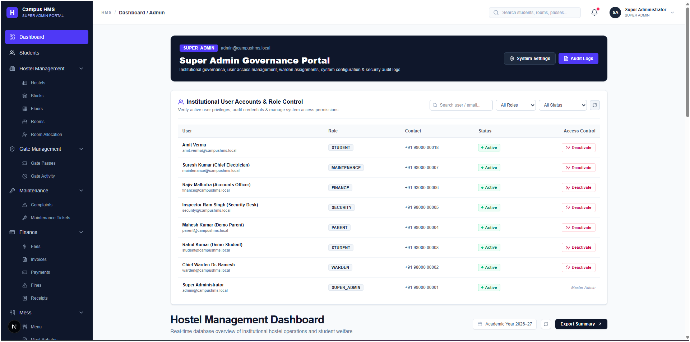
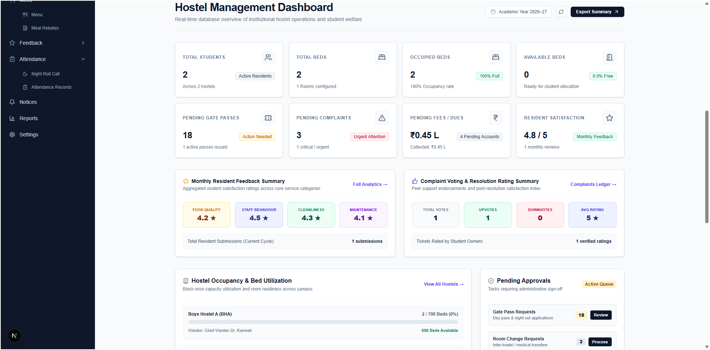
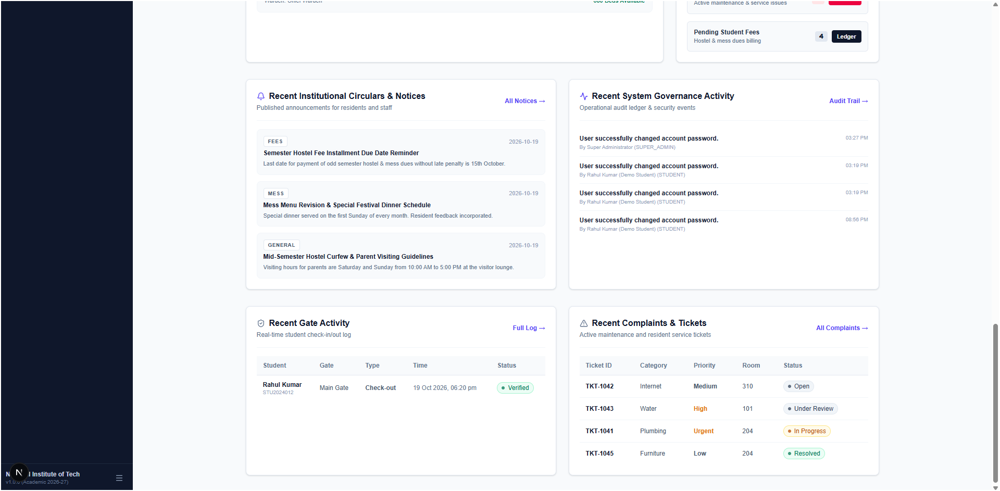

# Campus Hostel Management System

A web-based Campus Hostel Management System designed to manage hostel operations, student accommodation, complaints, feedback, room allocation, security activities, finance-related records, maintenance, and role-based workflows.

The system provides separate access and dashboards for different hostel stakeholders while maintaining role-based permissions and a common institutional interface.

---

## Project Overview

Managing hostel activities manually can make it difficult to maintain student records, room allocations, complaints, hostel operations, and related administrative information in one place.

The Campus Hostel Management System provides a centralized web application for managing these activities.

The system is designed around different user roles so that each user can access the functions relevant to their responsibilities.

---

## User Roles

The system supports separate workflows for:

- **Super Admin**
  - Manage hostel-related information
  - Manage users and administrative information
  - View overall system information

- **Hostel Warden**
  - Monitor hostel operations
  - Manage room and allocation-related activities
  - Handle student complaints and operational workflows
  - View hostel statistics

- **Student**
  - View personal hostel information
  - View room/allocation information
  - Submit and manage complaints
  - Participate in complaint voting
  - Submit monthly feedback

- **Parent**
  - View information related to the linked student
  - Monitor relevant hostel information
  - Access parent-specific read-only information

- **Campus Security**
  - Access security and gate-related activities
  - View gate activity and gate-pass information

- **Finance & Accounts**
  - Manage and view fee-related information
  - View payments, invoices, fines and receipts

- **Facilities Maintenance**
  - Manage maintenance-related activities
  - Handle maintenance tickets and related workflows

---

## Main Features

### Authentication and Role-Based Access Control

- Separate login pages for different user roles
- Secure authentication workflow
- Role-based access control
- Protected application routes
- Unauthorized-access handling
- Role-specific dashboards

### Hostel and Room Management

- Hostel hierarchy
- Block management
- Floor management
- Room management
- Bed allocation
- Room capacity management
- Room allocation history
- Room change workflow
- Room asset/inventory information

### Student Management

- Student records
- Student hostel information
- Room and allocation information
- Student-specific dashboard
- Role-based access to student information

### Complaint Management

- Submit complaints
- View complaint details
- Complaint status and workflow
- Complaint resolution
- Complaint voting
- Complaint resolution rating

### Monthly Feedback

- Monthly resident feedback
- Feedback submission
- Feedback analytics
- Complaint and feedback-related analysis

### Hostel Operations

- Attendance
- Night roll call
- Notices
- Gate passes
- Gate activity
- Mess information
- Meal rebate information

### Finance

- Fees
- Payments
- Invoices
- Fines
- Receipts
- Finance dashboard

### Maintenance

- Maintenance dashboard
- Maintenance tickets
- Ticket details
- Maintenance workflow

### Administrative Dashboards

The system provides dashboards for different roles, including:

- Admin
- Warden
- Student
- Parent
- Finance
- Maintenance
- Security

---

## Technology Stack

### Frontend

- Next.js
- React
- TypeScript
- CSS

### Backend

- Next.js API routes
- TypeScript

### Database

- PostgreSQL
- Prisma ORM

### Authentication

- JWT-based authentication
- Password hashing
- Role-based authorization

### Development

- Node.js
- npm
- Git
- GitHub

---

## Application Structure

```text
campus-hostel-management-system/
│
├── prisma/
│   ├── migrations/
│   ├── schema.prisma
│   └── seed.ts
│
├── public/
│
├── src/
│   ├── app/
│   │   ├── api/
│   │   ├── dashboard/
│   │   ├── complaints/
│   │   ├── feedback/
│   │   ├── rooms/
│   │   ├── room-allocation/
│   │   ├── students/
│   │   ├── finance/
│   │   ├── maintenance/
│   │   ├── login/
│   │   └── ...
│   │
│   ├── components/
│   │   ├── auth/
│   │   ├── layout/
│   │   └── ui/
│   │
│   ├── lib/
│   │   ├── auth/
│   │   ├── db/
│   │   ├── permissions/
│   │   └── services/
│   │
│   └── types/
│
├── run-all-tests.ts
├── test-auth.ts
├── test-phase4.ts
├── test-phase5.ts
├── test-phase6.ts
├── package.json
├── prisma/
└── README.md
---

## Screenshots

The following screenshots show the Super Admin portal and selected sections of the Campus Hostel Management System dashboard.

### 1. Super Admin Portal



### 2. Hostel Statistics and Resident Feedback



### 3. Recent Activity, Notices, and Maintenance Tickets


